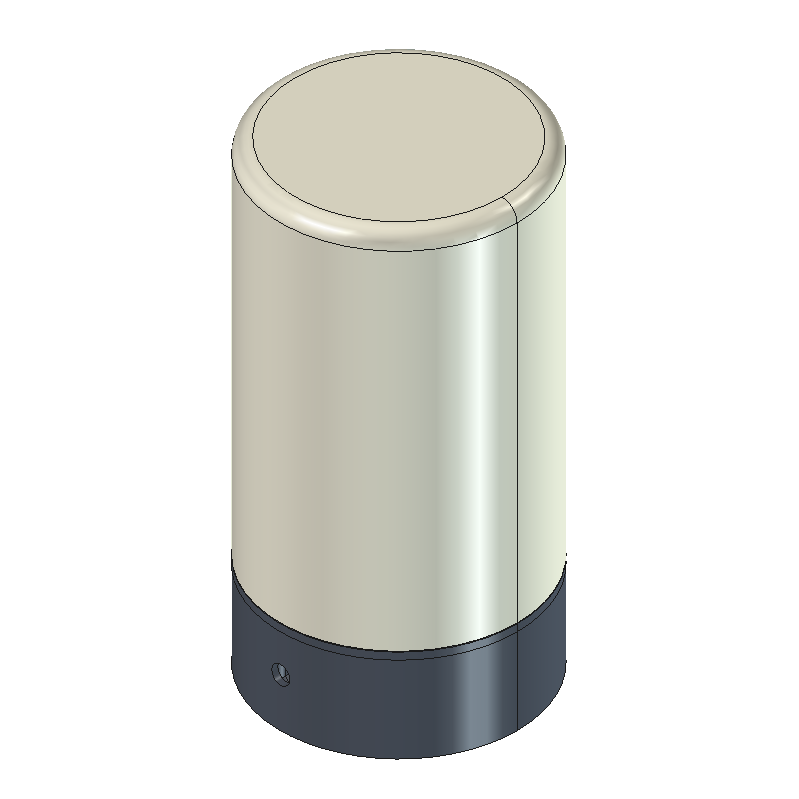
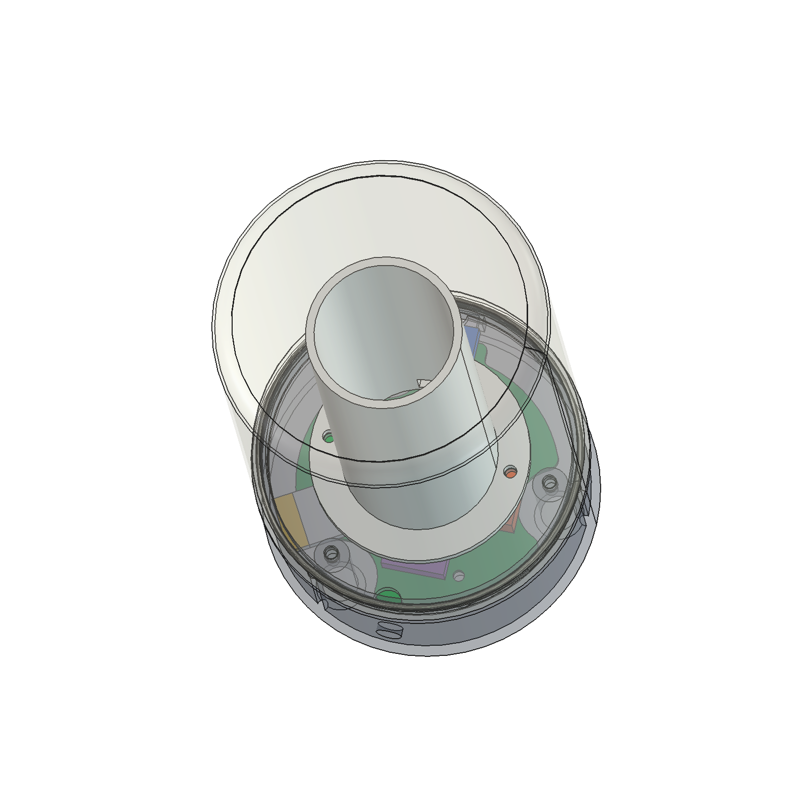
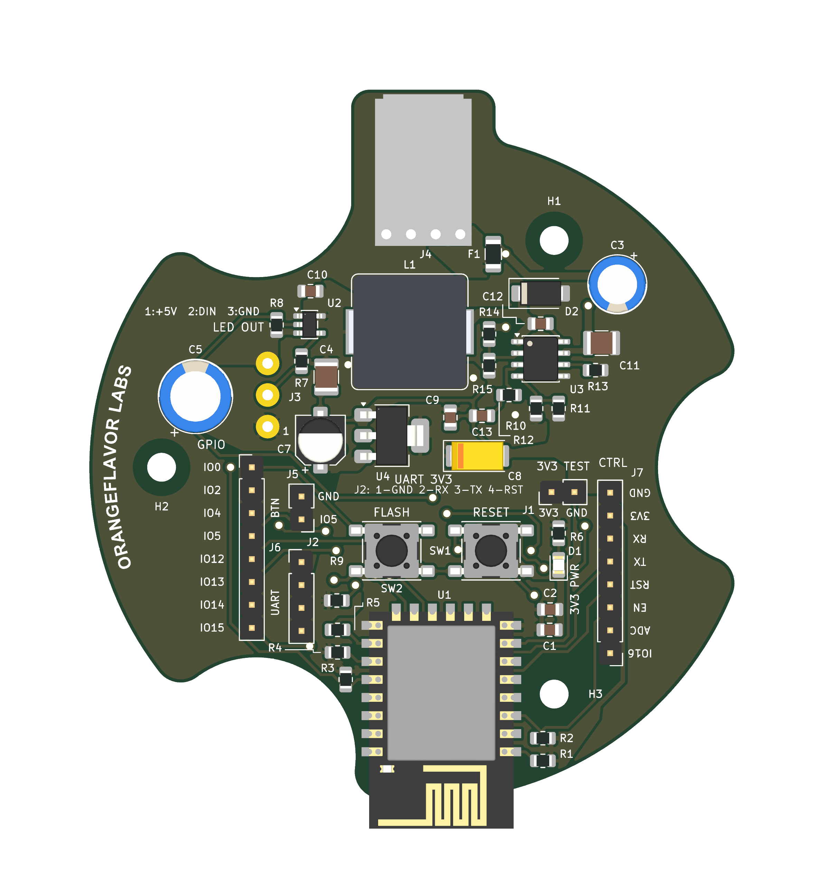

# RGB Sleep Lamp

A USB-C-powered RGB lamp with a 3D-printed enclosure, an ESP-12F controller, and a WS2812B LED strip. This repository preserves the mechanical design, electronics revisions, custom libraries, fabrication exports, and design-review evidence.

## Mechanical design

| Assembled lamp | Transparent internal view |
| --- | --- |
|  |  |

These saved CAD previews illustrate the enclosure and internal arrangement; the component blocks in the transparent view are placement references. The latest editable enclosure is the native FreeCAD document linked below.

[Open the FreeCAD design](mechanical/freecad/RGB%20Sleep%20Lamp.FCStd) · [Assembly animation](mechanical/freecad/RGB-Sleep-Lamp-native-assembly.mp4) · [Exploded-view animation](mechanical/freecad/RGB-Sleep-Lamp-explode-reverse.mp4)

## Open the current designs

| Design | Main file |
| --- | --- |
| Editable mechanical enclosure | [RGB Sleep Lamp.FCStd](mechanical/freecad/RGB%20Sleep%20Lamp.FCStd) |
| Electronics E5 project | [circuit.kicad_pro](electronic-design/revisions/5/circuit.kicad_pro) |
| E5 PCB | [circuit.kicad_pcb](electronic-design/revisions/5/circuit.kicad_pcb) |
| E5 schematic | [circuit.kicad_sch](electronic-design/revisions/5/circuit.kicad_sch) |
| E5 fabrication package | [Gerber ZIP](electronic-design/revisions/5/fabrication/20261031-E5/RGB-Sleep-Lamp-E5-Gerber-20261031.zip) |

Open the electronics through its KiCad project so the included project settings and local footprint library are available. The E5 layout was saved and checked with KiCad 10.0.7. Custom footprints, artwork and component models are included beside the design files.

## Hardware

- ESP-12F / ESP8266 controller.
- WS2812B strip: 50 cm, 60 LEDs/metre, 30 LEDs total.
- Power architecture: USB-C PD source, PDC004 fixed-20 V trigger module, 5 V buck converter, then 3.3 V regulation for the controller.
- The LED strip operates from the 5 V rail. No mains circuitry is inside the enclosure.
- Rounded PCB outline, three mounting holes, GPIO/programming headers and LED output connector.

## E5 status

All E4 track/via routing was removed and rebuilt. E5 retains the physical component placement, pad geometry/nets, models, PCB outline and curved ORANGEFLAVOR LABS artwork. Reference labels were adjusted around the new via holes.

- Minimum track width and copper-clearance rule: **0.3 mm**.
- All 33 vias: **0.8 mm drill / 1.2 mm outside copper diameter**.
- Approximately 71.85% of routed track length is on the top layer.
- Top power/GND pours and bottom GND pour are included.
- Recorded native DRC: **0 violations, 0 unconnected items, 0 schematic-parity issues**, with all DRC checks active and no exclusions.
- Native board renders, GerbView review and fabrication ZIP checksums are recorded in [validation.json](electronic-design/revisions/5/validation.json).

These are digital validation results from 2026-10-31. Physical fit, donor-component dimensions/values, thermal, RF and functional testing remain provisional or not run. The fabrication package is marked `PRODUCTION_REVIEW_PENDING`.

[Bottom view](electronic-design/revisions/5/renders/pcb-e5-bottom.png) · [DRC report](electronic-design/revisions/5/drc-final.rpt)

## Repository layout

- `mechanical/freecad/`: native working enclosure, checkpoints, review images and assembly media.
- `mechanical/revisions/`: preserved mechanical revisions through R9 and their original source/exports. These historical exports may differ from the newer editable FreeCAD document.
- `mechanical/printing/`: existing printer-specific print outputs.
- `electronic-design/revisions/`: preserved electronics E1–E5, libraries, models, checks and exports.
- `electronic-design/planning/`: earlier placement and mechanical-planning material.
- `documentation/`: attachments, design checks, named backups and original project metadata.

Relative compatibility links such as `current-electronics`, `current-mechanical`, `electronics`, and `revisions` are preserved. `electronic-design/current` points to E5; `mechanical/current` points to the R9 export snapshot. Use the editable FreeCAD file above for ongoing enclosure work.

Named design checkpoints and explicit revision folders are versioned. OS metadata, editor locks, KiCad local UI state and editor-internal `.history` repositories stay local.

## Firmware

Application firmware and Google Home integration are planned; this initial import contains the hardware design. WLED, a custom ESP8266 firmware, and the integration approaches discussed for the lamp have not yet been installed or validated on this hardware.
